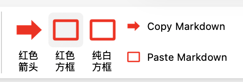

# PowerPoint 快捷工具加载项



在 PowerPoint 的“开始”选项卡加入五个按钮：

- **红色箭头**：插入实心红色右箭头。
- **红色方框**：插入透明填充、3 磅红色描边方框。
- **纯白方框**：插入白色填充、无描边方框。
- **Copy Markdown**：将选中的文字或一条原生公式复制为 Markdown。
- **Paste Markdown**：把剪贴板中的普通 Markdown 插入当前幻灯片；单独一条公式插入为 PowerPoint 原生可编辑公式。

插入后的箭头、方框或文本框会被自动选中，可以马上拖动、缩放或旋转。Markdown 文本目前处理标题、项目符号、整段加粗/斜体和粘贴内容中的 `**加粗**`、`*斜体*`。单独复制 `$p_1=p_2=10^{-4}$`、`$$P_{\mathrm{emp}}=\frac{n_{\mathrm{null}\geq\mathrm{obs}}+1}{N_{\mathrm{null}}+1}$$`，或者不带美元符号的 `P_{\mathrm{emp}}=\frac{n_{\mathrm{null}\geq\mathrm{obs}}+1}{N_{\mathrm{null}}+1}`，点击 Paste Markdown 会插入原生可编辑公式。加载项在当前演示文稿中临时导入公式页并清理，不再打开另一份 PPT。通过本加载项粘贴且未修改的公式，Copy Markdown 会复制粘贴时的完整原文；其他原生公式仍由转换器生成等价 Markdown。转换器需要 PowerPointApi 1.10、Pandoc 和本机 Word 的公式转换文件；公式粘贴使用 macOS PowerPoint 的 AppleScript 自动化权限。混在段落里的简单上下标仍会转换成 Unicode 文字；图片、表格及复杂混排不能完整往返。过长的内容需要分段粘贴。

## 首次安装

仅支持 macOS。先安装 Microsoft PowerPoint、Microsoft Word、Node.js、Python 3（含 lxml）、Pandoc 和 OpenSSL，再在项目目录运行：

```bash
./setup.sh
```

macOS 可能要求确认将本地开发证书加入登录钥匙串。确认后继续。

安装脚本会安装本地 MathJax 渲染组件，并启动一个仅监听本机的后台服务，以后不需要保持终端窗口打开。**先确认正在编辑的文件已经保存**，再重新启动 PowerPoint，打开任意演示文稿。在“开始”选项卡右侧找到“快捷工具”。如果按钮没有自动出现，请点击“开始”→“加载项”→“PowerPoint 快捷工具”。

## 本地检查

```bash
./verify.sh
```

加载项页面、公式渲染代码和剪贴板接口只在本机 `https://localhost:3000` 提供，不上传演示文稿内容。建议先用空白测试演示文稿验证，再用于正式文件。

## 许可

MIT，见 `LICENSE`。MathJax 通过 npm 安装，不包含在仓库中。
